# democ

Make demo videos from YAML, browser scenes, and Blender shots. Edit the script, preview it in a browser, and export an MP4 with FFmpeg and MLT.

[](https://www.python.org/) [](https://www.blender.org/) [](https://ffmpeg.org/) [](#demos) [](LICENSE)

## Demos

Click a preview to open the MP4. Each demo links to its source.

<!-- demos:start -->

|  |  |  |  |
| :--- | :--- | :--- | :--- |
| **Figma Slides**<br>[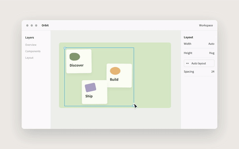](docs/demos/auto-layout.mp4)<br>[MP4](docs/demos/auto-layout.mp4) · [Source](engine/scenes/motion.js) | **Framer**<br>[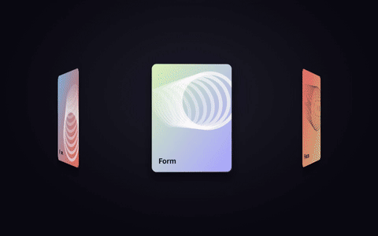](docs/demos/spatial-carousel.mp4)<br>[MP4](docs/demos/spatial-carousel.mp4) · [Source](engine/scenes/motion.js) | **Screen Studio**<br>[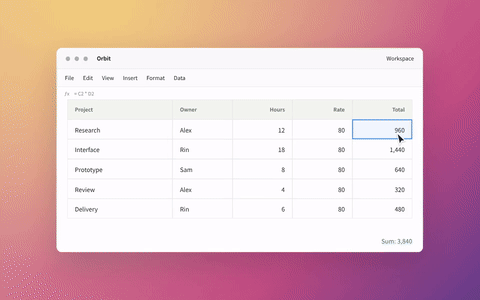](docs/demos/cursor-zoom.mp4)<br>[MP4](docs/demos/cursor-zoom.mp4) · [Source](engine/scenes/motion.js) | **Apple Mac mini**<br>[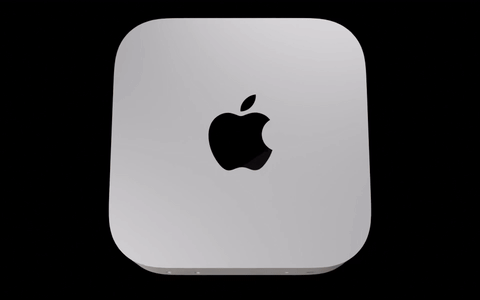](docs/demos/port-orbit.mp4)<br>[MP4](docs/demos/port-orbit.mp4) · [Source](templates/library/hardware.py) |
| **Apple AirPods Pro**<br>[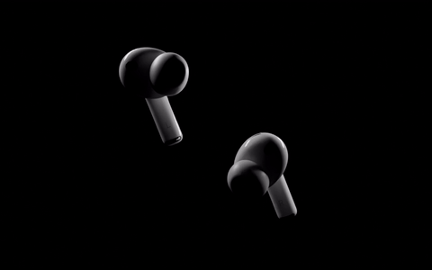](docs/demos/rim-reveal.mp4)<br>[MP4](docs/demos/rim-reveal.mp4) · [Source](templates/library/quality_scenes.py) | **teenage engineering OP–XY**<br>[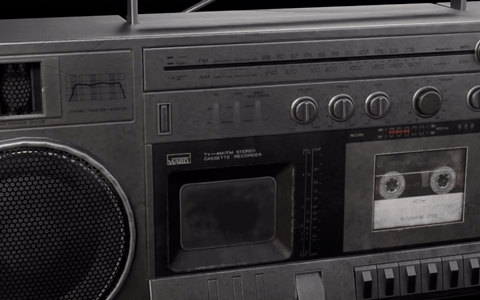](docs/demos/macro-controls.mp4)<br>[MP4](docs/demos/macro-controls.mp4) · [Source](templates/library/hardware.py) | **DJI Mavic 4 Pro**<br>[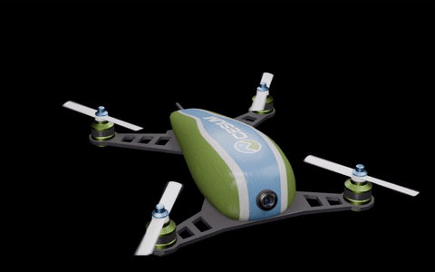](docs/demos/drone-orbit.mp4)<br>[MP4](docs/demos/drone-orbit.mp4) · [Source](templates/library/quality_scenes.py) | **Unitree G1**<br>[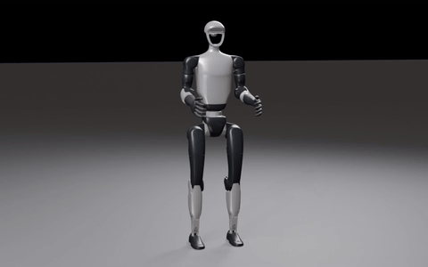](docs/demos/humanoid-articulation.mp4)<br>[MP4](docs/demos/humanoid-articulation.mp4) · [Source](templates/library/quality_scenes.py) |
| **NASA · EPIC**<br>[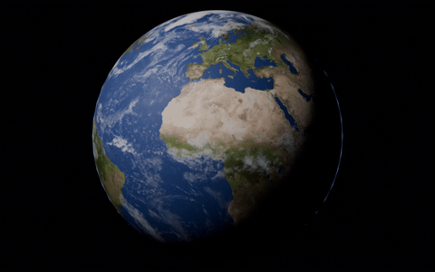](docs/demos/orbital-earth.mp4)<br>[MP4](docs/demos/orbital-earth.mp4) · [Source](templates/library/quality_scenes.py) | **Mapbox GL JS**<br>[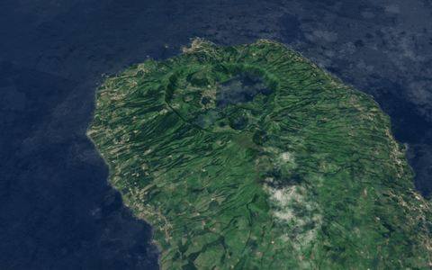](docs/demos/terrain-flyover.mp4)<br>[MP4](docs/demos/terrain-flyover.mp4) · [Source](templates/library/quality_scenes.py) | **Charm Gum**<br>[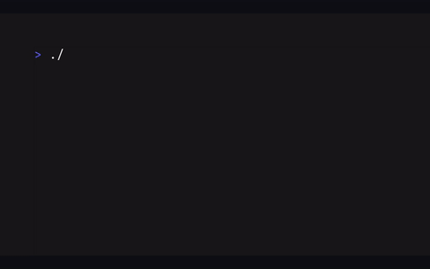](docs/demos/terminal-flow.mp4)<br>[MP4](docs/demos/terminal-flow.mp4) · [Source](engine/scenes/source-ui.js) | **GitHub Copilot · VS Code**<br>[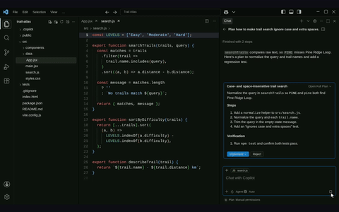](docs/demos/code-diff.mp4)<br>[MP4](docs/demos/code-diff.mp4) · [Source](engine/scenes/source-ui.js) |
| **XNOHub**<br>[](docs/demos/network-globe.mp4)<br>[MP4](docs/demos/network-globe.mp4) · [Source](engine/scenes/network-globe.js) | **TradingView Advanced Charts**<br>[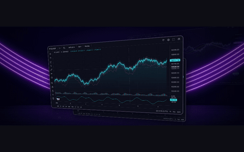](docs/demos/market-chart.mp4)<br>[MP4](docs/demos/market-chart.mp4) · [Source](engine/scenes/source-ui.js) | **Apple · Type punch**<br>[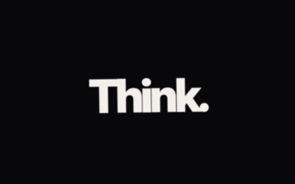](docs/demos/type-punch.mp4)<br>[MP4](docs/demos/type-punch.mp4) · [Source](engine/scenes/typography.js) | **Apple · Letter flight**<br>[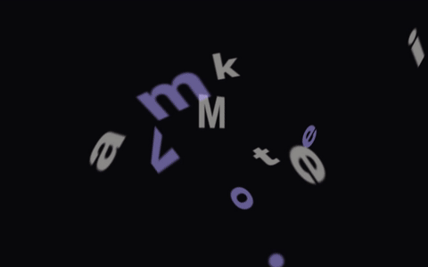](docs/demos/type-flight.mp4)<br>[MP4](docs/demos/type-flight.mp4) · [Source](engine/scenes/typography.js) |
| **Spotify Mix · Variable type**<br>[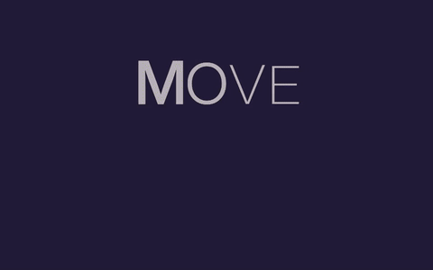](docs/demos/type-morph.mp4)<br>[MP4](docs/demos/type-morph.mp4) · [Source](engine/scenes/typography.js) | **Newsroom · Cascade**<br>[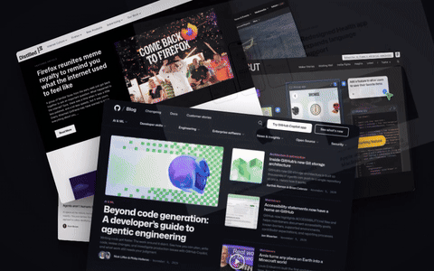](docs/demos/press-cascade.mp4)<br>[MP4](docs/demos/press-cascade.mp4) · [Source](engine/scenes/press.js) | **Newsroom · Wall**<br>[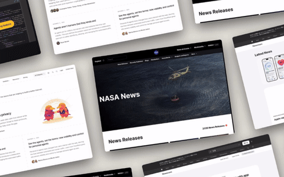](docs/demos/press-wall.mp4)<br>[MP4](docs/demos/press-wall.mp4) · [Source](engine/scenes/press.js) |  |

<!-- demos:end -->

See the [demo library](templates/library/README.md) for references, source assets, and reproduction notes.

## Getting started

```sh
git clone https://github.com/NyxFoundation/democ.git
cd democ
nix develop .#full
make new N=my-demo
make edit N=my-demo
```

Edit `out/my-demo/my-demo.yaml` and check the result in your browser. To export:

```sh
make out/my-demo/build/demo.mp4
```

The MP4, generated HTML, assets, and editing timeline are saved under `out/my-demo/`.

Without Nix, install Python 3.12, uv, Chromium, FFmpeg, and MLT (`melt`). Blender 5.x is required for 3D scenes; Node.js and npm are required for the first build of the UI templates.

## Editing a demo

### Text and timing

The script lives in `out/my-demo/my-demo.yaml`. Set `title` for the browser preview and `text` for the text shown in each scene.

```yaml
title: My Product
accent: "#5fd7d7"
transition: {duration: 0.3}
scenes:
  - type: card
    text: "From an idea<br>to <em>a release.</em>"
    hold: 2.4
  - type: card
    text: "github.com/your/project"
    hold: 2.0
```

Reorder `scenes` to change the sequence. `hold` sets the scene length in seconds; `transition.duration` sets the transition length. The [scene reference](docs/scenes.md) lists the available types and options.

```sh
make watch N=my-demo             # Rebuild HTML when the script changes
make edit N=my-demo              # Open the preview; press F5 to refresh
make out/my-demo/build/demo.mp4  # Record changed scenes and export
```

### Layout, 3D, and cuts

| To change | Edit |
| --- | --- |
| UI layout, colors, and animation | JS and CSS in `engine/scenes/` |
| Blender geometry, materials, and cameras | Python and `.blend` files in `out/my-demo/shots/` |
| Scenes that use 3D footage | YAML in `out/my-demo/layers/` |
| Final cut order and timing | Run `make open N=my-demo` to open Kdenlive |

After changing a 3D shot, run `make 3d` and export the MP4 again. Use Kdenlive for final cuts; make text changes in the YAML script.

See [3D and layers](docs/layers-and-3d.md) and the [pipeline notes](docs/architecture.md) for details.

### Library demos

Edit a demo's `title`, `duration`, or `parameters` in the [catalog](templates/library/catalog.yaml), or change its implementation, then render it again:

```sh
uv run --with pyyaml --with playwright python3 tools/template_library.py render \
  --id terminal-flow --force
make library-catalog                # Update the comparison page
make readme-demos ID=terminal-flow   # Update the README preview and MP4
```

## Templates and assets

```sh
make new N=my-demo FROM=nyxis   # Start from an existing demo
make library                  # Build the reference and comparison pages
make library-materials        # Fetch assets and inspect them in Blender
make example N=my-demo        # Save the script and source under examples/
```

Work files and generated output go in `out/`, which is ignored by Git. Shared scripts go in `examples/`. README previews and MP4s go in `docs/demos/`.

Asset sources and terms are recorded in the [asset inventory](templates/library/ASSETS.md). The [UI source notes](templates/library/source-ui/SOURCES.md) describe the third-party code used by the templates. Some linked documentation is in Japanese.

## Contributing

Issues and pull requests are welcome. When adding a scene, document its options and an example in the [scene reference](docs/scenes.md), then check the generated HTML and MP4.

## License

The project's code is licensed under the [MIT License](LICENSE).

Third-party code, fonts, and media retain their own licenses and terms. See the [asset inventory](templates/library/ASSETS.md), [UI source notes](templates/library/source-ui/SOURCES.md), and license files alongside those assets.
